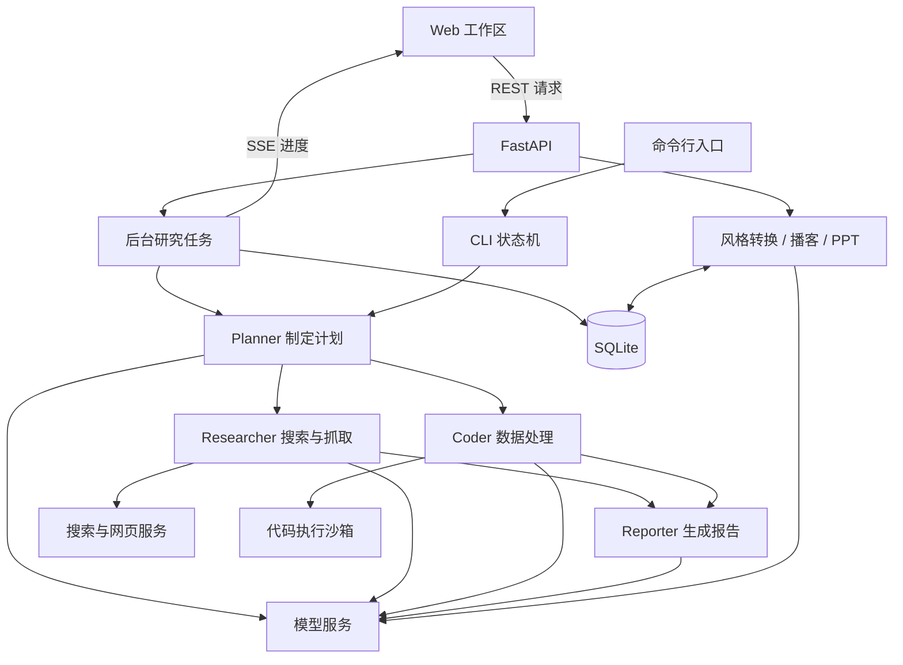

# ResearchMesh

## 简介

ResearchMesh 是一个支持本地运行的 AI 深度研究应用。输入研究主题后，系统自动制定研究计划、检索网络资料、执行必要的数据处理，并整理成带引用链接的结构化报告。

应用提供 Web 工作区和命令行入口。Web 工作区支持实时查看研究进度、管理历史记录、切换报告风格，以及将报告转化为播客脚本和幻灯片内容。

## 功能介绍

| 功能 | 说明 |
|---|---|
| 自动研究 | 根据主题生成计划，按步骤收集资料或执行数据处理，汇总形成报告 |
| 实时进度 | 展示研究计划、当前执行步骤、报告生成状态和研究过程 |
| 历史记录 | 搜索已有研究，从历史列表或侧栏最近记录直接打开报告 |
| 报告阅读 | 加宽正文区域、顶部吸附工具栏，支持 Markdown 标题、列表、表格和引用链接 |
| 报告风格 | 通用、学术、科普、新闻、社交媒体、投资分析，共六种风格，可直接点击切换 |
| 播客脚本 | 将研究报告转化为双人对话脚本，在弹窗中查看和下载 |
| PPT 内容 | 将报告转化为幻灯片 Markdown，在弹窗中查看和下载 |
| 结果复用 | 生成成功的风格版本、播客和 PPT 保存到本地数据库，再次打开时复用 |
| 编辑与导出 | 支持在页面中编辑报告并导出 Markdown |
| 主题与布局 | 浅色、深色主题，可折叠侧栏及手机导航抽屉 |

后端提供文本润色、扩写和精简 API。

## 使用说明

### 1. 准备环境

- Python 3.11 或更高版本。
- Node.js 与 npm，建议 Node.js 20.19 或更高版本，以满足当前开发工具依赖要求。
- 自己的 DeepSeek API Key 和 Tavily API Key。

以下操作在项目根目录执行。

获取项目：

```shell
git clone https://github.com/wmxxhb/ResearchMesh.git
cd ResearchMesh
```

### 2. 安装依赖

创建 Python 虚拟环境并安装完整后端依赖：

```shell
python -m venv .venv
```

激活虚拟环境：

Windows PowerShell：

```powershell
.venv\Scripts\Activate.ps1
```

macOS / Linux：

```bash
source .venv/bin/activate
```

安装后端依赖：

```shell
python -m pip install -r backend/requirements.txt
```

在项目根目录安装前端依赖：

```shell
npm --prefix frontend ci
```

### 3. 配置 API

将根目录的 `.env.example` 复制为 `.env`，填入自己的密钥：

```dotenv
DEEPSEEK_API_KEY=你的DeepSeek密钥
TAVILY_API_KEY=你的Tavily密钥
```

常用可选配置：

| 配置项 | 用途 |
|---|---|
| `DEEPSEEK_BASE_URL` | 模型服务地址，默认 `https://api.deepseek.com` |
| `PLANNER_MODEL` | 计划生成模型 |
| `RESEARCHER_MODEL` | 资料研究模型 |
| `REPORTER_MODEL` | 报告生成模型 |
| `REPORTER_FALLBACK_MODEL` | 报告备用模型 |
| `MAX_STEPS` | 最大研究步骤数 |
| `DASHSCOPE_API_KEY` | 阿里百炼备用模型服务密钥 |
| `SERPAPI_API_KEY` | 备用搜索服务密钥 |

其他参数见 `.env.example`。修改 `.env` 后重启后端使配置生效。

### 4. 启动应用

终端一，激活虚拟环境后启动后端：

```shell
python -m uvicorn backend.app.main:app --host 127.0.0.1 --port 8000
```

终端二，同样在项目根目录启动前端：

```shell
npm --prefix frontend run dev -- --hostname 127.0.0.1 --port 3000
```

启动后访问：

- 应用页面：[http://localhost:3000](http://localhost:3000)
- 后端 API 文档：[http://localhost:8000/docs](http://localhost:8000/docs)

前端默认连接 `http://localhost:8000`。使用其他后端地址时，在前端环境中设置 `NEXT_PUBLIC_API_URL` 并重启前端，同时配置后端的 `CORS_ORIGINS` 允许对应的网页来源。

### 5. 创建与查看研究

1. 点击侧栏“新建研究”，输入主题或具体问题，点击发送按钮开始。
2. 查看自动生成的计划、执行步骤和报告生成进度；“研究过程”可展开查看记录。
3. 完成后直接阅读报告。以后可以通过“研究历史”或侧栏最近记录重新打开。
4. 在报告顶部点击风格按钮切换版本。没有生成过的风格首次使用时需要生成，已有版本直接复用。
5. 点击“播客脚本”或“PPT 幻灯片”，在弹窗中查看内容并下载 Markdown。
6. 点击“重新生成”可更新对应的报告风格、播客或 PPT 内容。
7. 如需修改报告，点击“编辑报告”；完成编辑后可导出 Markdown 保存到本地。

页面根据模型调用量展示估算费用。

### 6. 使用命令行

激活虚拟环境后运行：

```shell
# 单次研究
python -m cli.main "你的研究主题"

# 跳过计划确认，并限制研究步骤数
python -m cli.main "你的研究主题" -y --max-steps 3

# 交互模式
python -m cli.main --interactive
```

命令行使用独立的状态机与交互流程；Web 研究由后端任务自动执行。

## 技术架构

### 技术栈

| 层级 | 实现 |
|---|---|
| Web 前端 | Next.js 16、React 19、TypeScript、Tailwind CSS 4 |
| 内容展示 | react-markdown、remark-gfm |
| 应用接口 | FastAPI、Uvicorn |
| 任务执行 | 进程内后台任务、Python asyncio |
| 实时进度 | Server-Sent Events（SSE） |
| 数据存储 | SQLite，启用 WAL 模式 |
| 模型调用 | OpenAI 兼容 SDK；DeepSeek 为主，支持阿里百炼模型路由 |
| 搜索与抓取 | Tavily、备用 SerpAPI、HTTP 抓取和正文提取 |
| 代码执行 | 子进程沙箱，支持 Docker 模式 |
| 提示词 | `prompts/` 下的版本化 Markdown 文件 |

### 应用结构



网页研究任务由 `backend/app/services/research.py` 编排。计划中需要搜索的步骤进入 Researcher，数据处理步骤进入 Coder，最后由 Reporter 整合研究发现。命令行通过 `cli/state_machine.py` 编排，复用相同的 Agent 模块。

### 结果保存与复用

- `research_tasks`、`research_steps` 保存研究任务、步骤和原始报告。
- `generated_outputs` 按任务、内容类型、语言和风格保存生成结果。
- 风格转换、播客和 PPT 接口默认先读取已有结果；`regenerate: true` 才重新生成并覆盖对应版本。
- 前端保留当前页面的风格版本与成果物状态，切换风格不会重建整个报告工具栏。
- 页面编辑后的报告内容通过 Markdown 导出保存。

### 主要目录

```text
项目根目录/
├── frontend/
│   ├── app/                 # 新建研究、历史与报告页面、全局样式
│   ├── components/          # 侧栏、报告工具、成果物弹窗、基础控件
│   └── lib/                 # API 客户端与类型
├── backend/
│   ├── app/
│   │   ├── api/routes/      # 研究、事件、报告和成果物接口
│   │   ├── core/            # 数据库与事件管理
│   │   └── services/        # 后台研究任务
│   └── researchmesh.db          # 研究记录与生成结果
├── cli/
│   ├── agents/              # 研究与内容生成 Agent
│   ├── tools/               # 搜索、抓取、代码执行
│   └── state_machine.py     # 命令行编排
├── prompts/                 # 运行时提示词
├── evals/                   # 可选的 Agent 评测工具
└── .env                     # 密钥与配置
```

SQLite 数据库位于 `backend/researchmesh.db`，保存研究记录和生成结果。`prompts/` 提供 Agent 运行时使用的提示词。命令行生成的报告与记录写入 `output/` 等运行目录。
